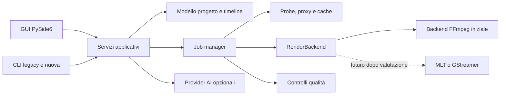

## Aggiornamento: diagnostica e output Qwen 3.5 (2026-11-15)

La risposta richiesta ha un JSON Schema atomico con scene in cui narrativa, script, storyboard e ID media sono nello stesso record, evitando array disallineati. Il provider interroga `/api/show`: invia `think:false` solo se supportato esplicitamente, altrimenti `low` se disponibile o lascia il valore predefinito. Il parser rimuove wrapper comuni (prosa/fence) ma richiede un singolo oggetto completo, rifiuta chiavi duplicate, campi errati e ID media fuori catalogo; è consentito un solo retry.

La diagnostica è scritta atomicamente sotto `%LOCALAPPDATA%\REEL_ENGINE\logs\ai_director` (fallback `logs/ai_director`), con massimo 20 file e 64 KiB di risposta grezza per tentativo. Include metadati e errori HTTP/parser, redige percorsi locali e non conserva prompt, percorsi dei media o contenuto thinking. L’output potrebbe ripetere il brief. Il percorso viene mostrato in GUI in caso di errore.

Il 15/11/2026 Ollama 0.40.16 ha rilevato Qwen 3.5 4B, con thinking attivo per default e `false` supportato. Prova sintetica: ~3 minuti e scene disallineate col default; JSON valido in ~5,2 s con `think:false` nel test diretto semplice; flusso end-to-end aggiornato: 4 scene valide in 119,71 s. Il run utente originario non aveva output grezzo; sappiamo che `json.loads(message.content)` lo rifiutò, ma non è possibile ricostruirne la forma specifica. Riferimenti: [chat API](https://docs.ollama.com/api/chat), [thinking](https://docs.ollama.com/capabilities/thinking), [Qwen 3.5 4B](https://ollama.com/library/qwen3.5:4b).

## AI Video Director Fase 2 — adapter Ollama locale

`OllamaProvider` implementa `DirectorProvider` senza SDK o dipendenze aggiuntive, tramite `urllib` standard. Accetta solo HTTP loopback, disabilita proxy ambientali e redirect, legge modelli installati da `GET /api/tags` e genera con `POST /api/chat`, `stream: false` e JSON Schema nel campo `format`. Prima di invocare il modello richiede che il nome esatto compaia nell’elenco installato; non chiama endpoint di pull/download. Rete e parsing hanno timeout, limite risposta di 1 MB e messaggi d’errore espliciti.

La GUI offre modalità template/Ollama, combo editabile popolata dai modelli, timeout e controllo connessione. Verifica e generazione usano `QRunnable`/`QThreadPool`, lasciando disponibile l’interfaccia. Il payload AI contiene brief e un catalogo ristretto a `media_id`, nome file, tipo e durata; i percorsi locali non vengono inviati. La risposta JSON deve avere soltanto narrativa, script e storyboard, da 1 a 50 scene, campi testuali non vuoti e `media_id` presente nel catalogo. Il core costruisce i percorsi timeline dall’ID catalogo, mai da testo del modello, e salva la provenienza `ollama:<modello>` nelle impostazioni progetto. Il provider template resta il default alternativo.

L’output rimane `project.json` v1 con Timeline JSON v1 e scene valide; lo storyboard/script completo e il catalogo sono metadati in `project.settings.ai_director`. Il progetto viene aperto nell’editor e l’export rimane un’azione esplicita dell’utente. Errori Ollama non producono un draft fallback silenzioso. Test usano un server HTTP simulato su loopback e non Internet.

Interfacce e formato sono basati sulle [API ufficiali chat](https://docs.ollama.com/api/chat), [elenco modelli](https://docs.ollama.com/api/tags) e [structured outputs](https://ollama.com/blog/structured-outputs). Il runtime Ollama e i modelli non sono inclusi né scaricati dal progetto. La nota d’ambiente del 14/11 (CLI assente, endpoint rifiutato) è superata: il 15/11 il server locale Ollama 0.40.16 e Qwen 3.5 4B sono stati rilevati. Diagnosi e prove sul modello sono descritte nella sezione aggiornata sopra; compatibilità con altri modelli/hardware non è generalizzata.

## AI Video Director — workflow e confine provider

Il package core `reel_engine.director` orchestra fasi distinte: interpretazione del brief, struttura narrativa, script guida, storyboard, associazione ai media selezionati e preparazione del progetto. Il contratto `DirectorProvider` permette di sostituire il generatore senza legare il modello al vendor. `TemplateDraftProvider` è l’unico provider incluso: usa regole/template deterministici, è marcato nel progetto come `local-template` e non è presentato all’utente come AI. Non è presente alcun modello o servizio remoto.

La GUI (`gui/director.py`, accessibile dalla Home) raccoglie tema, durata, formato, istruzioni, media e destinazione. Visualizza la bozza e richiede l’azione esplicita dell’utente per creare il progetto; poi apre il progetto nell’editor esistente, dove il preview precede l’export manuale via Job Manager. Immagini e video sono associati alle scene sequenziali; FFprobe controlla le durate video senza decodificare frame e il planner limita ogni scena video alla sua sorgente. Se il solo materiale video non copre la durata richiesta, il flusso fallisce con indicazione di aggiungere immagini o ridurre la durata. Non effettua download, generazione media, voce o chiamate di rete.

Il risultato è `project.json` formato progetto v1 e Timeline JSON v1 non modificata. Le scene contengono soltanto i campi supportati dallo schema; brief, stato/provider, script guida e storyboard sono in `project.settings.ai_director`, fuori dalla timeline. Il salvataggio usa l’API atomica del progetto e ripulisce il file vuoto iniziale in caso di errore durante la preparazione. Le risorse sorgente restano riferimenti agli originali; l’export continua a seguire l’editor/Job Manager e non usa proxy.

**Gate per la vera generazione AI:** scegliere esplicitamente un provider o un runtime locale; ottenere autorizzazione prima di eventuali API a pagamento; verificare privacy, conservazione dei dati, licenze e costi; validare l’output strutturato prima di convertirlo in Timeline v1; mantenere preview, revisione e avvio export sotto controllo utente. Stato attuale: contratto provider e flusso draft/progetto operativi, generazione tramite modello non disponibile.

# Architettura REEL ENGINE

## Confronto backend video e decisione — 2026-11-14

### Architettura esistente osservata

`TimelineEditorPage` presenta una timeline sequenziale JSON v1 e usa player Qt separati per preview normale e compositing crossfade. `JobManager` esegue un solo lavoro alla volta, pubblica solo dopo QC e accetta un renderer callable (default `render_timeline`). Il renderer attuale crea segmenti FFmpeg, compone crossfade/testi/audio con comandi e filtergraph, concatena e passa da FFprobe/decodifica prima della pubblicazione. Non esiste ancora un modello generico di clip liberamente sovrapposte, effetti o tracce video indipendenti; la GUI presenta però righe visuali distinte. Quindi un engine NLE non si innesta come un encoder: richiede un adapter dal modello, semantica equivalente e un test di compatibilità d'export.

### Matrice funzionale e operativa

| Aspetto | FFmpeg attuale | MLT | GStreamer Editing Services (GES) |
|---|---|---|---|
| Modello editing | Filtergraph/procedure d'export; nessuna timeline NLE nativa. L'app costruisce segmenti e composizione. | Framework di composizione con playlist, tracce, filtri, transizioni, keyframe/easing e profili; serializza anche in XML MLT. | API editor: `GESTimeline`, tracce di output, layer utente e clip; `GESPipeline` per preview/play/render. Gli overlap nella stessa track sono regolati e al massimo due sorgenti possono sovrapporsi nello stesso istante. |
| Transizioni ed effetti | Ampia libreria di filtri e transizioni, incluse `xfade`, overlay e mix; flessibilità alta ma il prodotto deve tradurre i concetti UI in filtergraph. | Transizioni tra tracce, numerosi filter/service e animazione dei parametri. La disponibilità e licenza dipendono dai moduli scelti. | `GESTransitionClip`/auto-transition e `GESEffect`; gli effetti sono elementi GStreamer descritti da bin/pipeline. Plugin disponibili dipendono dal pacchetto installato. |
| Audio | `amix`, `acrossfade`, fade, filtri e mapping esplicito; già integrato con QC. | Tracce/mixer e filtri audio nel modello di composizione. | Track audio, elementi pipeline e plugin; l'app deve selezionare e distribuire i plugin codec/effetti necessari. |
| Preview e seek | FFmpeg CLI è batch, non un motore interattivo; preview corrente resta Qt Multimedia e il suo compositing crossfade. | Framework può produrre preview scalata/consumer, ma serve integrare consumer/playhead/seek nella GUI. | `GESPipeline` supporta preview e render dalla timeline; occorre integrare pipeline e sink nella finestra Qt e con il ciclo seek/playback esistente. |
| Python e Windows | Nessun binding: il progetto avvia `ffmpeg`/`ffprobe` come processi, isolando l'app dai dettagli ABI. | API Python SWIG `mlt7`; Windows è supportato via MinGW, ma la documentazione pubblica di build/binding Windows consultata mostra istruzioni legacy e non dimostra un wheel Python 3.14 pronto per il venv corrente. | GES ha supporto Windows ufficiale e GStreamer pubblica binari MSVC/MinGW. Python usa GObject Introspection/PyGObject; la guida Windows documenta MSYS2/UCRT64. GStreamer 1.28 annuncia anche il bundle PyPI, ma GES + CPython 3.14 + PySide6 in un installer REEL ENGINE resta da provare. |
| Licenze/distribuzione | FFmpeg è LGPL per impostazione base, ma opzioni GPL cambiano la licenza; build e librerie esterne vanno verificate. La build installata qui è statica e dichiara `--enable-gpl --enable-version3 --enable-libx264`, dunque non è il profilo neutro da redistribuire con un prodotto proprietario senza revisione/licenza del componente. Codec H.264 e altri formati richiedono valutazione separata dei brevetti per i mercati target. | Il framework è LGPL 2.1, `melt`/`melted` sono GPL e alcuni moduli/dependency tree possono essere GPL; va costruito un inventario per la build effettiva. | GES/core sono LGPL, ma i pacchetti plugin sono misti; la distribuzione Windows distingue pacchetti e segnala GPL/codec con potenziali brevetti. Un bundle minimale è possibile, ma richiede allowlist di plugin, SBOM/notice e verifiche codec. |
| Hardware/risorse | La build corrente usa `libx264` software nel renderer; NVENC è presente ma non utilizzato. Non richiede la GPU per funzionare. FFmpeg avverte che accelerazione/trasferimenti GPU non sono sempre più veloci. | Offre multithreading, GPU/OpenGL e accelerazione a seconda del consumer, moduli/build e driver; non è una garanzia di più basso uso RAM. | Dipende dai plugin e dai decoder/encoder scelti; hardware acceleration è supportata da alcune pipeline, non uniforme fra codec/driver. |

Fonti primarie: [licenza FFmpeg](https://www.ffmpeg.org/legal.html), [documentazione filtri FFmpeg](https://ffmpeg.org/ffmpeg-filters.html), [feature MLT](https://www.mltframework.org/features/), [policy copyright MLT](https://mltframework.org/docs/copyrightpolicy/), [binding Python MLT](https://mltframework.org/doxygen/group__python__bindings.html), [Windows build MLT](https://mltframework.org/docs/windowsbuild/), [architettura GES](https://gstreamer.freedesktop.org/documentation/gst-editing-services/index.html), [limitazioni overlap GES](https://gstreamer.freedesktop.org/documentation/gst-editing-services/gestimeline.html), [licenze GStreamer](https://gstreamer.freedesktop.org/documentation/frequently-asked-questions/licensing.html), [deployment Windows GStreamer](https://gstreamer.freedesktop.org/documentation/deploying/windows.html), [download e Python bundle GStreamer](https://gstreamer.freedesktop.org/download/), [PyGObject Windows](https://pygobject.gnome.org/getting_started.html).

**Valutazione hardware per il target dichiarato:** la macchina di sviluppo ha 16 GB RAM e GTX 1660 SUPER; il render software seriale e i proxy 960 px non richiedono la GPU per funzionare. Questo rende ragionevole continuare il profilo attuale per preview/export 1080×1920, ma non è un benchmark né una garanzia per 4K, codec pesanti o più lavori simultanei. Non aumentare la concorrenza del Job Manager e non pubblicizzare un requisito minimo prima di misurare CPU/RAM/VRAM e seek su fixture reali.

### Decisione

Mantenere **FFmpeg come unico backend di export renderizzato** per la fase attuale. Motivi: è già installato e verificato, copre il formato sequenziale corrente, è integrato con Job Manager/cancellazione/QC e l'interfaccia di render resta semplice. Il preview interattivo attuale resta Qt Multimedia. Aggiungere MLT o GES adesso duplicherebbe gestione codec, seek, filtri, distribuzione e verifica dell'output senza rispondere a una capacità richiesta che il modello attuale non può rappresentare. Non introdurre ora un secondo backend né migrare il formato progetto in XML GES/MLT.

Quando REEL ENGINE richiederà davvero clip liberamente sovrapposte, effetti non distruttivi e compositing multitraccia, condurre un pilot GES per primo (timeline/track/clip/effect API e distribuzione Windows ufficiale sono un buon allineamento), mantenendo MLT come comparatore. Gate obbligatori prima della scelta: stessa timeline-fixture importata da adapter, confronto frame/audio, seek deterministico, consumo RAM/CPU su macchina target, installazione pulita CPython 3.14 + PySide6, licenze esatte dei plugin/codec e packaging senza installer di sviluppo. Non è stata fatta una prova runtime/benchmark MLT o GES: in questa macchina i relativi strumenti/binding non sono installati e non sono state aggiunte dipendenze.

### Gate di distribuzione commerciale

La build FFmpeg installata è `9.0.2-essentials_build-www.gyan.dev`, configurata con `--enable-gpl --enable-version3 --enable-static --enable-libx264` (oltre a NVENC/D3D11VA); il renderer usa attualmente `libx264`. Non redistribuire questa build come default del prodotto senza una revisione precisa delle condizioni GPL e dei codec/patenti. Percorso raccomandato: produrre un manifesto dei componenti/codec, scegliere fra una distribuzione GPL esplicitamente compatibile oppure una build FFmpeg separata conforme al profilo scelto (senza componenti GPL/nonfree se richiesta compatibilità proprietaria), quindi selezionare un encoder supportato e collaudarlo su Windows pulito. La seconda opzione richiede un encoder alternativo al `libx264` hardcoded e non è inclusa in questa decisione. La licenza LGPL del framework non determina da sola i diritti sui codec o sui plug-in. Verifica legale per i territori di vendita prima della pubblicazione; questa è una valutazione ingegneristica, non un parere legale.

### Stili di transizione condivisi tra GUI, preview ed export — 2026-11-14

L'editor popola il menu **Transizione** dalle 22 opzioni `CROSSFADE_STYLES`. La preferenza viene salvata sotto `project.settings.editor.crossfade_style`, separata da `timeline`; se assente o non valida viene risolta a `fade`. `_crossfade_frame` condivide il compositing fra preview seek/playback per immagini e frame video: dissolve a celle, wipe/slide, maschere circolari/radiali, aperture orizzontali/verticali, fade attraverso nero/bianco e zoom. Lo stile viene scelto ad ogni frame senza riaprire i decoder solo per un cambio di menu. `JobManager` riapre le impostazioni salvate e passa la scelta a `render_timeline` come `crossfade_style`, quindi l'export usa lo stesso filtro FFmpeg `xfade`. Renderer diretti e vecchi progetti mantengono `fade`; renderer custom che non dichiarano l'opzione restano compatibili.

La preferenza non viene inserita nella timeline JSON v1. La GUI preview costruisce la transizione lato Qt, mentre il render FFmpeg usa il filter nativo con lo stesso nome; sono implementazioni visive distinte e richiedono una futura prova manuale frame-per-frame se si vuole certificare identità pixel esatta. I test Qt verificano la selezione/persistenza, la resa wipe e che tutti i 22 stili producano frame; i test Job Manager verificano propagazione impostazione e default `fade`.

## Raccolta esplicita dei media nel progetto (2026-11-14)

`project.collect_project_media` itera le stesse referenze media/font usate da diagnostica e portabilità. Prima verifica che tutti gli asset esistano, poi copia soltanto quelli esterni in `media/` o `fonts/`, con nome derivato da SHA-256 e copia temporanea pubblicata con replace atomico. Aggiorna i riferimenti e salva `project.json`; se copia o salvataggio fallisce, ripristina i riferimenti e rimuove i nuovi file. L'editor espone l'azione **Raccogli media**. I file di origine non vengono modificati e il renderer continua a consumare le normali referenze della timeline v1, ora interne e relative. La copia è attualmente sincrona nell'azione GUI.

## GUI: selezione e preview immagini (2026-11-11)

`TimelineEditorPage.add_media_paths` crea una voce scena per ogni file immagine/video e ricostruisce i clip grafici senza cambiare lo schema timeline JSON v1. `select_item` aggiorna inspector, clip evidenziato e testina; `seek_to` individua la scena contenente il tempo e chiama `_show_scene`. Durante playback il timer delle immagini porta la testina avanti e `_advance_scene` aggiorna scena, selezione e preview al confine temporale. Il video segue il tempo emesso da QMediaPlayer. Il salvataggio passa la timeline al modello progetto, che mantiene il suo salvataggio atomico.

Le immagini vengono lette con `QImageReader` (auto-rotazione inclusa) prima di creare la pixmap. In caso di file mancante o non decodificabile, il preview si arresta e mostra messaggio e percorso; l'importazione non nasconde l'errore con lo stato generico. Nessuna modifica al renderer, alla CLI o al formato dei progetti è necessaria per questo flusso.

## GUI e renderer: continuità audio e durata effettiva (2026-11-12)

L'editor distingue la durata visiva (scene con sovrapposizioni crossfade) dalla fine effettiva della timeline. La durata effettiva è il massimo tra fine visiva e fine `background_audio`: `duration` se configurata, altrimenti durata FFprobe della sorgente meno `source_in`. La misura senza durata esplicita è memorizzata in cache per percorso, mtime e dimensione, ed è arrotondata in avanti al fotogramma del canvas. I titoli creati dalla GUI restano limitati alla durata visiva, in accordo con la validazione corrente di timeline v1.

Durante la riproduzione, l'audio viene sincronizzato all'avvio e ai seek manuali. Il cambio di fotografia o video non richiama il setup dei player, non cambia la posizione e non ricarica il file. Il timer delle scene gestisce anche la coda dopo l'ultima scena: ferma il video, mostra il messaggio di intervallo vuoto e continua ad aggiornare testina, cursore e tempo fino alla fine effettiva; quindi mette in pausa i player.

Il renderer calcola la fine effettiva con la stessa semantica e l'allinea al frame. Voce e musica vengono trim/pad alla durata finale; quando la musica supera le scene il video viene esteso con fotogrammi neri. Se l'audio è più corto, il video resta integro e la traccia audio viene completata con silenzio. FFprobe e test FFmpeg verificano durata, stream audio e fotogramma nero della coda. Non cambia lo schema JSON v1 né viene introdotta una dipendenza.

## GUI: importazione persistente, preview e miniature (2026-11-12)

`TimelineEditorPage.add_media_paths` convalida l'intero gruppo selezionato, prepara le nuove scene senza mutare la timeline attiva e le salva attraverso `save_project` prima di confermare l'importazione nell'interfaccia. Un errore di scrittura ripristina in memoria la timeline precedente. Ogni file produce una scena distinta nella sequenza, con asset assoluto risolto; il modello progetto serializza poi i media interni relativi e conserva esterni assoluti. Il formato timeline v1 e le API di progetto non cambiano.

Il preview usa un `QStackedWidget` esclusivo per immagine/stato vuoto e video. L'overlay è un widget fratello collocato sopra lo stack, non un terzo elemento di uno stack `StackAll`: una superficie QVideoWidget non attiva non resta più visibile sopra la pagina immagine. Selezione, seek e player video continuano a usare gli stessi metodi di scena.

`TimelineWidget` aggiunge miniature solo alle scene immagine. `QImageReader` usa autorotazione e decodifica ridimensionata; `QPixmap` è mantenuta in una cache LRU per widget (massimo 96 voci), con chiave composta da percorso canonico, data di modifica e dimensione file. I clip video e le altre tracce restano nella rappresentazione precedente. Le miniature vengono disegnate in una geometria locale ritagliata al clip, con etichetta leggibile sovrapposta.

La copertura Qt verifica importazione di due fotografie, JSON salvato, riapertura/percorsi leggibili, preview vuoto/immagine/video e riuso della cache. Questi test automatizzati non attestano ancora un test manuale con i media originali dell'utente sul suo PC.

## GUI: click sulle intestazioni timeline (2026-11-12)

`TimelineWidget.mousePressEvent` riconosce la colonna delle intestazioni (`x < _LEFT`) nelle quattro bande traccia e consuma il click senza inoltrarlo a `QGraphicsView`. Così l'evento non arriva alla scena e non cancella la selezione del clip. Fuori dalle intestazioni resta il comportamento esistente: i clip emettono la richiesta di selezione; la zona temporale emette `seek_requested` e aggiorna la testina. La modifica è confinata alla presentazione/event routing: nessun cambio al modello, JSON v1, renderer o Job Manager. Il test Qt verifica anche che Inspector e preview risultino visibili dopo i click sulle intestazioni; non è una prova manuale dell'intera finestra sullo schermo dell'utente.

## Principi approvati

La direzione approvata nella Fase 12 è un'evoluzione incrementale: Python per applicazione e servizi, PySide6 per la futura interfaccia desktop e FFmpeg/ffprobe come primo backend media. Il modello progetto e la timeline devono restare indipendenti dai comandi FFmpeg. La modalità CLI legacy va mantenuta durante la transizione.

La GUI non deve eseguire operazioni lunghe nel thread principale. Media originali, progetto, cache, proxy, workspace temporanei ed esportati devono essere distinti. AI locale e cloud sono provider opzionali; nessun invio cloud o consumo crediti automatico. L'utente mantiene approvazione e controllo sulle modifiche suggerite dall'AI.

## Schema dei componenti



## Responsabilità

- **Dominio:** progetto, sequenze, tracce, clip, asset, preset, timing e validazione. Il formato interno non deve essere una filter graph FFmpeg.
- **Servizi applicativi:** importazione, apertura/salvataggio, validazione, preview, export e coordinamento dei casi d'uso.
- **GUI PySide6:** schermate, libreria media, preview, timeline, inspector, export e visualizzazione errori/progresso. Iniziare con una GUI essenziale; valutare QML solo in base a bisogni reali.
- **Servizi media:** ffprobe per metadati, thumbnail e proxy rigenerabili. Non modificare gli originali.
- **RenderBackend:** interfaccia fra modello e motore. FFmpeg è l'implementazione iniziale; MLT/GES sono alternative da confrontare prima di adottarle.
- **Job manager:** workspace univoci, processi, log, avanzamento, annullamento e raccolta risultati. Nessun nome intermedio globale condiviso.
- **QC:** verifica tecnica dell'export e report di errori/avvisi.
- **AI provider:** adapter indipendenti per strumenti locali o cloud. I risultati sono proposte/asset tracciabili, mai modifiche silenziose alla timeline.

## Timeline e timing

Lo schema attuale v1 supporta canvas, audio principale, sottofondo opzionale, scene sequenziali immagine/video con durata e `source_in`, testi, sottotitoli e transizioni. Il renderer FFmpeg e l'editor visuale consumano la stessa timeline. Conservare il significato dei campi correnti e introdurre migrazioni di schema esplicite quando necessario.

Il modello attuale conserva le scene in sequenza e gli intervalli di audio, testi e sottotitoli in secondi; le transizioni crossfade riducono la durata finale. La GUI presenta righe separate per video, audio, testi e sottotitoli e calcola le posizioni sulla scala temporale, ma non introduce ancora un modello generico di clip sovrapposte o di effetti audio.

OpenTimelineIO può essere valutato come formato di interscambio, non come sostituto del modello completo del progetto o del motore di rendering.

## Progetti e file

Il core persiste i progetti in `project.json`, con `format: "reel-engine-project"` e `format_version: 1`; la timeline incorporata resta uno schema JSON v1 indipendente, così il formato legacy continua a essere usato dal renderer CLI. Il documento contiene nome, impostazioni, timeline e campi superiori sconosciuti conservati durante apertura e salvataggio. La timeline iniziale può essere vuota e viene completata dall'applicazione prima del render.

In fase di salvataggio i riferimenti media interni alla cartella progetto vengono scritti relativi; i riferimenti esterni restano assoluti. L'apertura espande i percorsi relativi rispetto alla cartella del progetto. I media non vengono copiati o modificati. La diagnostica segnala in modo puntuale i riferimenti mancanti senza impedire il recupero o la modifica del progetto. Il salvataggio serializza in UTF-8 su un temporaneo nella stessa cartella, sincronizza il file e lo pubblica con sostituzione atomica; errori di scrittura/sostituzione lasciano intatto il documento precedente. Migrazioni del formato progetto oltre la versione 1 richiederanno una strategia esplicita.

API core in `src/reel_engine/project.py`: `create_project`, `open_project`, `save_project`, `update_project_timeline` e `diagnose_project`. La GUI aggiunge clip come riferimenti ai media esistenti, senza copiarli; i percorsi interni diventano relativi in salvataggio e restano assoluti quando esterni alla cartella progetto.

## Rendering, preview e QC

`JobManager` offre una coda FIFO e un worker seriale, con stati `queued`, `running`, `completed`, `failed` e `cancelled`. Ogni lavoro da progetto salvato ha un ID, timestamp, percentuale/fase, log e workspace univoco sotto `temp/jobs`. Il registro `job_registry.json` è versionato e aggiornato atomicamente; conserva cronologia e coda, ripristina i lavori in attesa e marca come interrotti quelli attivi al riavvio. Non riprende un processo FFmpeg interrotto; riconcilia invece il caso in cui la pubblicazione atomica fosse già stata completata. Il backend FFmpeg continua a ricevere un modello timeline validato e avvia subprocess senza shell; il job legge il canale `-progress`, registra i messaggi e l'annullamento termina soltanto il processo FFmpeg corrente. La CLI legacy continua a invocare direttamente il renderer senza coda.

Il primo preview usa `QMediaPlayer`/`QVideoWidget` per video e `QPixmap` per immagini; la riproduzione scorre le scene, mantiene il cursore temporale e riproduce le tracce audio. Gli overlay temporizzati sono visibili nel preview. Le transizioni crossfade sono applicate nel rendering FFmpeg, ma non composte in tempo reale dal preview. Proxy e preview composito crossfade sono successivi. La cache rigenerabile della waveform è descritta sotto. Al termine del render, verificare presenza, dimensione, stream, durata, risoluzione, frame rate e decodificabilità; aggiungere in seguito test per audio, sync, loudness, silenzi, fotogrammi neri e sottotitoli.

Il programma salva l'export in un file provvisorio dentro il workspace del job. Prima della pubblicazione verifica che esista, contenga stream audio/video e durata positiva, e che FFmpeg riesca a decodificarlo; poi sostituisce atomicamente la destinazione. È vietato usare come destinazione il file progetto o uno dei media/font referenziati. Una cancellazione/fallimento rimuove il file provvisorio, conserva log e non pubblica il risultato. Gli intermedi FFmpeg restano limitati al workspace e vengono rimossi dal renderer; non si toccano media originali. I materiali preesistenti in `temp`, `renders`, `backups` o cartelle media non sono temporanei automaticamente.

## AI e risorse

L'integrazione AI deve dichiarare provider, modello, requisiti hardware, destinazione dei dati e possibili costi. I cloud provider richiedono consenso esplicito; credenziali non vanno salvate nei progetti. I modelli e i runtime restano separati e opzionali.

Il PC rilevato ha 16 GB RAM e una GTX 1660 SUPER con 6 GB VRAM; al controllo la memoria libera era circa 1,23 GiB. Evitare caricamento di media originali nella GUI e concorrenza illimitata fra AI, preview e render. Il volume D: Seagate Basic dispone di molto spazio, ma tipo fisico e velocità non sono stati verificati: i percorsi di cache e lavoro devono essere configurabili.

## Struttura proposta (graduale)

```text
src/reel_engine/
  domain/       # modello progetto, timeline, asset e preset
  application/  # casi d'uso e coordinamento
  media/        # probe, thumbnail, proxy
  rendering/    # RenderBackend e backend FFmpeg
  jobs/         # workspace, progresso, cancellazione
  gui/          # finestre e widget PySide6
  ai/           # provider opzionali, in fase successiva
scripts/
  reel_engine.py # entry point legacy compatibile
tests/
  unit/
  integration/
```

La riorganizzazione va fatta per passi, mantenendo temporaneamente il layout attuale e verificando i test dopo ogni estrazione. Non introdurre ora plugin framework, database, microservizi o backend multipli.

### Primo package desktop

`src/reel_engine/gui/` ospita l'interfaccia PySide6 opzionale; il core (`project`, `jobs`, timeline e renderer) non importa Qt. `scripts/reel_engine_gui.py` è il launcher Windows e `requirements-gui.txt` dichiara la dipendenza desktop separata. `MainWindow` coordina Home, diagnostica e apertura dei progetti recenti; `TimelineEditorPage` visualizza preview, timeline e inspector. I media selezionati vengono aggiunti al JSON v1, `save_project` conserva il lavoro e `JobManager` gestisce l'export in un worker isolato. La GUI ha controlli di riproduzione/seek, proprietà per scene/audio/testi/sottotitoli e diagnostica delle risorse mancanti.

## Verifica pratica GUI (2026-11-11)

La prova end-to-end ha collegato `MainWindow` → `TimelineEditorPage` → `Project` v1 → `JobManager` → renderer FFmpeg/QC. Le risorse sintetiche sono rimaste inalterate; il progetto è stato chiuso e riaperto dallo stesso `project.json`; l'output finale è stato pubblicato dal Job Manager dopo i controlli. Il progetto di verifica si trova nell'area temporanea del thread indicata in `PROJECT_STATUS.md`, fuori dal repository. Il Job Manager di prova ha usato un workspace dedicato sotto la cartella di prova per mantenere isolato l'esperimento.


## Audio timeline opzionale (2026-11-12)

`Timeline.audio_asset` è opzionale. `validation.py` normalizza `audio: null` e campo omesso a `None`; il modello JSON v1 resta invariato. `rendering.py` costruisce gli input FFmpeg solo per le tracce esistenti: audio principale + sottofondo mantiene il mix, una sola traccia viene mappata direttamente e nessuna traccia produce video-only. La durata resta calcolata sui contenuti temporizzati e il sottofondo può prolungare le scene. `jobs.py` adatta il controllo stream FFprobe alla presenza di audio dichiarato, mantenendo video e decodifica come requisiti sempre obbligatori.


## Riordino nella timeline GUI (2026-11-12)

`TimelineWidget` avvia un drag della scena solo dopo `QApplication.startDragDistance()`, visualizza il punto d'inserimento e invia gli indici sorgente/destinazione a `TimelineEditorPage.move_scene`. Il metodo crea una nuova lista d'ordine mantenendo inalterati i dizionari delle scene e gli altri gruppi temporali. Gli inizi scena derivano sempre dall'ordine, durata e sovrapposizioni crossfade; non è introdotto un campo posizione né una modifica al renderer. Prima di applicare il nuovo ordine, i riferimenti `transitions.between.after`, la somma dei frame crossfade e i fade terminali sono controllati contro le regole di validazione. L'anteprima e il playhead si spostano all'inizio della scena riordinata; il salvataggio resta esplicito con Salva/Ctrl+S.


## Split scena nell'editor (2026-11-13)

`TimelineEditorPage.split_selected` traduce il playhead globale in frame locali usando gli inizi scena derivati dalla sequenza e i frame rate del canvas. Crea due copie della scena: la prima mantiene l'ID, la seconda riceve un ID v1 valido. Le durate intere in frame sommano alla durata originale; per una sorgente video, il secondo `source_in` avanza dello stesso numero di frame usato dalla prima parte. Lo split non introduce campi JSON. La transizione `between` in uscita viene riassociata al nuovo ID della seconda parte; `_scene_order_issue` controlla che le transizioni risultino ancora valide. L'operazione costruisce una copia candidata e non applica nulla se il punto o le transizioni non sono compatibili. Audio, testi e sottotitoli rimangono su tempi assoluti.


## Seek del player video dopo split — 2026-11-13

`TimelineEditorPage._show_scene` confronta la URL del video richiesto con quella già aperta. Se è lo stesso asset, conserva il player e sposta la testina senza riaprire il file. Per una nuova sorgente memorizza URL, scena, posizione sorgente in millisecondi e stato play richiesto; `_video_status_changed` applica il seek quando Qt raggiunge `LoadedMedia` o `BufferedMedia`, e avvia solo se l'editor è ancora in riproduzione. Il renderer non richiede modifiche: `render_timeline` allinea `Scene.source_in` alla griglia frame e lo passa a FFmpeg con `-ss` prima di `-i`.


## Trim clip nella GUI

`TimelineWidget` riconosce i bordi delle clip VIDEO, fornisce cursore orizzontale e invia indice, lato e delta in frame a `TimelineEditorPage.trim_scene`. La pagina copia la timeline candidata, applica il taglio quantizzato con `seconds_to_frames`/`frames_to_seconds`, controlla minimo di un frame, confini sorgente video, transizioni e fine di testi/sottotitoli, quindi commette il risultato e ricostruisce playhead, anteprima e timeline. Il modello non acquisisce campi di posizione: la sequenza rimane senza gap. Sul bordo sinistro il video sposta `source_in` e riduce/aumenta la durata in modo inverso; le immagini conservano asset e `source_in`. Sul bordo destro varia la durata. La persistenza resta affidata al salvataggio progetto esistente e il renderer non è stato modificato.


## Cronologia Undo/Redo dell'editor

`TimelineEditorPage` possiede un `QUndoStack` PySide6 con limite di 100 comandi. Ogni operazione costruisce una timeline candidata e crea un `_TimelineSnapshotCommand` con snapshot indipendenti prima/dopo, selezione e playhead. `redo()`/`undo()` applicano lo snapshot tramite un unico percorso che riallinea `project.timeline`, starts, Inspector, anteprima, overlay e playhead senza salvare file. Importazione e rimozione, audio, overlay, proprietà, riordino, split e trim passano da questo commit. Le transizioni fanno parte dello snapshot intero, quindi sono ripristinate quando split/eliminazione le rimappano o rimuovono. Il clean index di QUndoStack si aggiorna solo dopo un salvataggio riuscito; il titolo progetto mostra `*` fuori dal clean index. La cronologia vive solo nella sessione GUI, non cambia il JSON v1 e viene cancellata all'apertura di un progetto. L'importazione continua a salvare subito come prima; Undo dopo l'import non sovrascrive il file fino al successivo Salva.


### Drag live del trim e cronologia
`TimelineWidget` conserva uno snapshot temporaneo all'inizio del gesto e aggiorna soltanto la geometria visuale durante il drag; i delta sono convertiti in frame con il frame rate della timeline. Il modello autorevole non cambia fino al rilascio. Un timer limita gli aggiornamenti dell'anteprima e usa temporaneamente la timeline candidata, poi ripristina il modello corrente. Al rilascio `TimelineEditorPage.trim_scene` valida sorgenti video, durata minima, transizioni e intervalli testo/sottotitolo, quindi commette un unico `_TimelineSnapshotCommand`. `Esc` e gli esiti non validi ripristinano timeline, selezione, playhead e preview. Il trim sinistro è un roll: aumenta la durata della scena precedente e diminuisce quella selezionata dello stesso numero di frame; `source_in` della scena video selezionata avanza dello stesso delta, conservandone l'uscita sorgente. La prima scena non ammette trim sinistro perché JSON v1 sequenziale non contiene una posizione iniziale. Il renderer e il formato progetto non sono stati cambiati.


## Snap magnetico nella timeline
`TimelineWidget._snap_seconds` confronta il puntatore con punti della timeline dopo averli proiettati sulle coordinate del viewport; la tolleranza di 10 px rimane quindi indipendente da scala/zoom. I target vengono generati da inizio/fine scene, punti interni delle transizioni fade/crossfade e posizione corrente del playhead. Una guida QGraphics tratteggiata mostra il target finché il gesto resta agganciato. La navigazione del playhead parte dalla scala superiore per non intercettare click, selezione o maniglie clip; `seek_requested` aggiorna il player. Il drag di riordino usa il punto agganciato per scegliere l'inserimento. Trim destro e Roll sinistro calcolano delta contro lo snapshot iniziale del gesto, escludono il bordo che si sta muovendo e includono il playhead iniziale come target, evitando deriva/oscillazione mentre il preview aggiorna la geometria. Gli output vengono quantizzati con il frame rate della timeline anche con snap disattivato. I comandi già presenti `_TimelineSnapshotCommand` registrano un solo Undo al rilascio. Pulsante e shortcut `N` operano solo nell'editor/timeline; nessuna dipendenza, persistenza di preferenza o modifica al JSON v1 è stata aggiunta.

### Waveform audio
`src/reel_engine/waveform.py` decodifica l'audio con FFmpeg in PCM mono a bassa frequenza di campionamento e riduce i blocchi a coppie min/max a 100 bin/s. La lettura è a blocchi, quindi non conserva in memoria tutto il PCM dei file lunghi. `WaveformCache` usa chiavi basate su percorso canonico, dimensione, date di modifica/creazione e versione algoritmo; mantiene una LRU RAM limitata e file cache compressi scritti atomicamente in `%LOCALAPPDATA%\REEL_ENGINE\waveforms` (fallback: cache utente). `TimelineWidget` avvia il calcolo in `QThreadPool`, sovrappone gli item alla traccia audio e disegna solo l'area visibile fino a un limite di colonne per frame paint. Zoom e scroll derivano dalle coordinate QGraphicsView; `source_in` sposta l'indice dei bin e il volume scala l'ampiezza. Un `QFileSystemWatcher` aggiorna la waveform quando cambia il file. La cache è solo visuale: Undo/Redo e riapertura ricostruiscono la vista dal progetto e recuperano i picchi in cache; renderer e JSON v1 non dipendono da essa.

### Copia/incolla scene nella GUI
`TimelineEditorPage` mantiene `_scene_clipboard` come copia profonda in memoria di una sola scena; non usa il clipboard OS e non aggiunge campi alla timeline. Gli shortcut `Ctrl+C`, `Ctrl+V` e `Ctrl+D` sono attivi nel widget timeline, così non intercettano l'editing dei campi Inspector. Il clone riceve un ID `scene_copy_NNN` libero. `paste_scene` traduce il playhead in indice scena: nel modello sequenziale v1, usa il successivo inizio scena e appende quando il playhead è oltre le scene; non crea gap o sovrapposizioni e non divide implicitamente una clip. `duplicate_selected_scene` inserisce dopo l'indice selezionato. Entrambi passano `_scene_order_issue` e `_push_timeline_change`, quindi validazione, preview, selezione/playhead e snapshot Undo/Redo seguono il normale flusso. Le scene sono singola selezione; multi-selezione non è implementata. Il buffer si azzera su `set_project`; il salvataggio resta esplicito.

## Track Lock — Blocco e sblocco tracce (2026-11-14)

`TimelineEditorPage` espone cinque pulsanti toggle posizionati sopra la timeline, uno per ogni traccia: **VIDEO (scene)**, **AUDIO**, **MUSICA (background\_audio)**, **TESTI** e **SOTTOTITOLI**. L'implementazione si articola nei seguenti componenti:

### Costanti

- `_TRACK_LOCK_LABELS` — dizionario `{chiave: etichetta_pulsante}` per le cinque tracce.
- `_TRACK_LOCK_DEFAULTS` — dizionario `{chiave: False}` usato come fallback al primo avvio o su progetti vecchi.
- `_TRACK_FIELDS` — mappa `{chiave: lista_campi_timeline}` che collega ogni traccia ai campi JSON v1 che tutela (es. `"scene": ["scenes"]`, `"texts": ["texts"]`); usata da `_locked_tracks_changed()` per capire se lo snapshot prima/dopo ha subito modifiche in una traccia bloccata.

### Metodi di controllo stato

- `_track_is_locked(key)` — restituisce `True` se la traccia è bloccata; usato come guard in ogni punto di mutazione.
- `_set_track_lock(key, locked)` — aggiorna lo stato interno, chiama `_sync_track_lock_buttons()` e marca il progetto non salvato.
- `_locked_tracks_changed(before, after)` — confronta snapshot prima/dopo su ogni campo gestito da tracce bloccate; se rileva modifiche in una traccia bloccata restituisce l'etichetta della traccia, così `_push_timeline_change()` può rifiutare l'operazione.
- `_read_project_track_locks()` / `_write_project_track_locks()` — carica/salva lo stato dei blocchi in `project.settings["editor"]["track_locks"]` al momento dell'apertura e del salvataggio del progetto.

### Sincronizzazione UI

- `_sync_track_lock_buttons()` — aggiorna l'etichetta e lo stile di ogni pulsante lock; disabilita anche i pulsanti di aggiunta rapida (`add_media_button`, `add_audio_button`, `add_music_button`, `add_text_button`, `add_subtitle_button`) in base allo stato dei blocchi.
- `_render_controls_enabled(enabled)` — quando `enabled=False` disabilita tutti i controlli; quando `enabled=True` delega a `_sync_track_lock_buttons()` perché i pulsanti rispettino i blocchi.

### Protezione delle operazioni

Ogni percorso di modifica esegue un guard prima di applicare la mutazione:

| Operazione | Guard |
|---|---|
| `import_video_or_images()` | esce prima del dialogo se la traccia VIDEO è bloccata |
| `import_audio()` | esce prima del dialogo se AUDIO o MUSICA è bloccata |
| `add_overlay("text"/"subtitle")` | bloccato da `_push_timeline_change()` via `_locked_tracks_changed()` |
| `delete_selected()` | bloccato da `_push_timeline_change()` |
| `ripple_delete_selected()` | check esplicito su TESTI/SOTTOTITOLI quando esistono testi/sottotitoli nel tratto da collassare |
| `split_selected()` | bloccato da `_push_timeline_change()` |
| `trim_scene()` | bloccato da `_push_timeline_change()` |
| `move_scene()` | bloccato da `_push_timeline_change()` |
| `paste_scene()` / `duplicate_selected_scene()` | bloccato da `_push_timeline_change()` |
| Inspector "Applica" | bloccato da `_push_timeline_change()` |
| Shortcut `Del`, `Ctrl+C/V/D`, `S`, `Shift+Del` | bloccati dai guard sopra |
| Cursore di hover trim | soppresso su clip VIDEO bloccata |

`_push_timeline_change()` chiama `_locked_tracks_changed(before, after)` prima di accettare il comando; se la chiamata restituisce un'etichetta, mostra il messaggio `Traccia [X] bloccata` nella barra di stato e restituisce `False`.

### Undo/Redo

`_refresh_history_controls()` controlla le tracce bloccate prima di abilitare i pulsanti Annulla/Ripristina: se lo snapshot che verrebbe applicato è relativo a una traccia bloccata, il pulsante rimane disabilitato. L'utente può sbloccare la traccia e riprovare.

### Feedback visivo (TimelineWidget)

`TimelineWidget.set_track_locks(locks)` riceve il dizionario dei blocchi e aggiorna il rendering delle clip:
- Le clip di tracce bloccate mostrano l'etichetta `[LOCKED]` sovrapposta.
- L'opacità delle clip bloccate è ridotta a 0,58.
- Il cursore di ridimensionamento non appare sui bordi delle clip bloccate.

### Persistenza

Lo stato dei blocchi è salvato in `project.settings["editor"]["track_locks"]` — **non** nello schema timeline JSON v1. Il renderer FFmpeg, la CLI e il Job Manager non leggono né dipendono da questo campo; l'export funziona normalmente anche con tracce bloccate. I progetti precedenti privi di questa chiave usano `_TRACK_LOCK_DEFAULTS` (tutto sbloccato), garantendo piena retrocompatibilità.

## Proxy video nell'editor
`gui/proxies.py::ProxyCache` archivia transcodifiche H.264 senza audio in `<project>/.reel_engine/proxies`. Il nome del proxy deriva dal percorso normalizzato e dal fingerprint dell'originale (size, mtime, ctime, file id), senza aggiungere riferimenti al documento progetto o alla timeline v1. La generazione FFmpeg vive in un `QRunnable` e scrive su un nome temporaneo univoco; prima del rename atomico controlla che il sorgente non sia cambiato. `TimelineEditorPage._preview_source_path()` sceglie il proxy solamente per i `QMediaPlayer` della preview e dei crossfade; `Project.timeline` conserva l'asset originale, usato dal render service. `settings.editor.use_proxies` salva la preferenza UI, con fallback attivo per i progetti precedenti. Un thread alla volta per editor limita il carico CPU/memoria; i worker osservano un evento di cancellazione per terminare FFmpeg alla chiusura.

### Ripple Delete nella GUI
`TimelineEditorPage.ripple_delete_selected` opera su una copia candidata della timeline. La durata rimossa è calcolata in frame come durata scena meno overlap crossfade in ingresso e uscita; il punto di collasso parte dalla fine dell'overlap entrante, così il tempo della scena precedente resta stabile. Le transizioni `between` collegate alla scena rimossa e al suo predecessore (i due tagli adiacenti) vengono tolte; le altre seguono gli ID scena. Start/end fades restano terminali e sono limitati ai frame disponibili della nuova prima/ultima scena. Per `texts` e `subtitles`, una mappa piecewise mantiene gli intervalli prima del taglio, collassa i punti interni al taglio e sottrae i frame rimossi a quelli successivi; intervalli degeneri vengono eliminati. `audio` è una sorgente globale da zero e `background_audio` è una sorgente globale con `source_in`/durata, non una clip posizionata: entrambi rimangono invariati e continui. La candidata viene verificata con `_scene_order_issue` e applicata tramite `_push_timeline_change`, garantendo un unico snapshot Undo/Redo, playhead e preview aggiornati e nessuna scrittura fino al salvataggio. Shortcut `Shift+Delete` limitata alla timeline; **Elimina selezione** conserva la semantica precedente. Nessuna modifica allo schema JSON v1 o al renderer.
## Guard di persistenza e lifecycle GUI — 2026-11-15

`MainWindow` centralizza la risoluzione dello stato dirty prima di cambiare pagina/progetto o accettare la chiusura. L’editor resta responsabile del salvataggio; in caso di errore la transizione è rifiutata. Lo scarto riapre il documento persistito e lo reimposta nell’editor. La chiusura accettata invoca `TimelineEditorPage.shutdown_for_teardown()`: arresto dei timer e player, cancellazione e drenaggio dei worker proxy cancellabili e disconnessione dei signal con callback che usano lo stato dell’editor. Il watcher delle waveform rinvia il refresh tramite un `QTimer` figlio, evitando callback Python anonime oltre la vita del widget. Anche la chiusura diretta di un editor mai mostrato esegue il teardown. Timeline JSON v1, renderer, Job Manager e AI Director restano fuori da questo flusso.

## UX editor — libreria, tracce e Job Manager — 2026-11-15

La GUI dispone la libreria a sinistra, preview al centro, Inspector/Esportazioni a destra e timeline in uno splitter inferiore. `project.settings.editor.media_library` conserva i percorsi importati come metadati GUI; non vengono inseriti nella sequenza finché l’utente non seleziona esplicitamente uno o più elementi. I progetti precedenti ricostruiscono il bin dalle scene esistenti. Le thumbnail video usano FFmpeg in un `QThreadPool` separato, con un solo worker e cancellazione durante il teardown; foto e anteprime timeline riusano la cache limitata già presente.

Gli header traccia sono una colonna Qt fissa separata dalla `QGraphicsView`, quindi lo scroll orizzontale riguarda solo il contenuto temporale. `_LEFT=0` rende identica l’origine temporale di righello, clip e interazioni. Lo zoom è un valore per istanza del widget; i controlli ricostruiscono gli elementi mantenendo il tempo sotto il centro viewport oppure adattando la durata al viewport.

La scheda Esportazioni interroga `JobManager.list_jobs/get_job/cancel` già esistente: timer GUI aggiorna fase/progresso/stato, la lista mostra la cronologia persistente e il log selezionato è letto in modo bounded. Il renderer e l’implementazione Job Manager non sono stati modificati.
