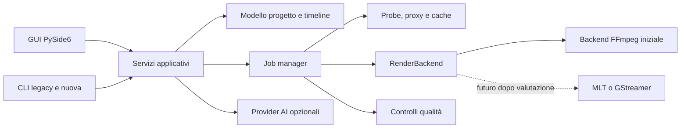

# Architettura REEL ENGINE

## Principi approvati

La direzione approvata nella Fase 12 è un'evoluzione incrementale: Python per applicazione e servizi, PySide6 per la futura interfaccia desktop e FFmpeg/ffprobe come primo backend media. Il modello progetto e la timeline devono restare indipendenti dai comandi FFmpeg. La modalità CLI legacy va mantenuta durante la transizione.

La GUI non deve eseguire operazioni lunghe nel thread principale. Media originali, progetto, cache, proxy, workspace temporanei ed esportati devono essere distinti. AI locale e cloud sono provider opzionali; nessun invio cloud o consumo crediti automatico. L'utente mantiene approvazione e controllo sulle modifiche suggerite dall'AI.

## Schema dei componenti



## Responsabilità

- **Dominio:** progetto, sequenze, tracce, clip, asset, preset, timing e validazione. Il formato interno non deve essere una filter graph FFmpeg.
- **Servizi applicativi:** importazione, apertura/salvataggio, validazione, preview, export e coordinamento dei casi d'uso.
- **GUI PySide6:** schermate, libreria media, preview, timeline, inspector, export e visualizzazione errori/progresso. Iniziare con una GUI essenziale; valutare QML solo in base a bisogni reali.
- **Servizi media:** ffprobe per metadati, thumbnail e proxy rigenerabili. Non modificare gli originali.
- **RenderBackend:** interfaccia fra modello e motore. FFmpeg è l'implementazione iniziale; MLT/GES sono alternative da confrontare prima di adottarle.
- **Job manager:** workspace univoci, processi, log, avanzamento, annullamento e raccolta risultati. Nessun nome intermedio globale condiviso.
- **QC:** verifica tecnica dell'export e report di errori/avvisi.
- **AI provider:** adapter indipendenti per strumenti locali o cloud. I risultati sono proposte/asset tracciabili, mai modifiche silenziose alla timeline.

## Timeline e timing

Lo schema attuale v1 supporta canvas, un audio e scene sequenziali immagine/video, con durata e `source_in`. Il renderer corrente gestisce solo immagini. Per l'evoluzione, conservare il significato dei campi correnti e introdurre migrazioni di schema esplicite.

Il modello futuro dovrà distinguere tempo timeline, tempo sorgente, frame rate e tempo audio. Preferire frame interi o tempi razionali a float persistenti. Le tracce possono comprendere video/immagini, voce, musica, effetti, titoli e sottotitoli. Tracce sovrapposte, compositing e transizioni sono obiettivi successivi, non requisiti da fingere già implementati.

OpenTimelineIO può essere valutato come formato di interscambio, non come sostituto del modello completo del progetto o del motore di rendering.

## Progetti e file

Il progetto persistente dovrà essere versionato e memorizzare impostazioni, sequenze e riferimenti agli asset. Supportare riferimenti esterni e, in seguito, una raccolta media esplicita scelta dall'utente. Segnalare gli asset mancanti; non copiare, spostare o sovrascrivere media senza un'azione esplicita. Cache e proxy sono ricostruibili e separati dal documento progetto.

## Rendering, preview e QC

Il backend FFmpeg interroga le capacità di FFmpeg/ffprobe e costruisce i comandi da dati validati, usando subprocess senza shell. Ogni job usa un workspace proprio. Il progresso va letto da un canale strutturato, mentre l'annullamento deve terminare solo il processo del job corrente.

La preview iniziale usa media leggeri/proxy per limitare consumo di memoria e GPU. Al termine del render, verificare presenza, dimensione, stream, durata, risoluzione, frame rate e decodificabilità; aggiungere in seguito test per audio, sync, loudness, silenzi, fotogrammi neri e sottotitoli.

Il programma deve salvare prima su un temporaneo del job e pubblicare l'output soltanto dopo i controlli. La pulizia può riguardare solo il workspace di quel job. I materiali preesistenti in `temp`, `renders`, `backups` o cartelle media non sono temporanei automaticamente.

## AI e risorse

L'integrazione AI deve dichiarare provider, modello, requisiti hardware, destinazione dei dati e possibili costi. I cloud provider richiedono consenso esplicito; credenziali non vanno salvate nei progetti. I modelli e i runtime restano separati e opzionali.

Il PC rilevato ha 16 GB RAM e una GTX 1660 SUPER con 6 GB VRAM; al controllo la memoria libera era circa 1,23 GiB. Evitare caricamento di media originali nella GUI e concorrenza illimitata fra AI, preview e render. Il volume D: Seagate Basic dispone di molto spazio, ma tipo fisico e velocità non sono stati verificati: i percorsi di cache e lavoro devono essere configurabili.

## Struttura proposta (graduale)

```text
src/reel_engine/
  domain/       # modello progetto, timeline, asset e preset
  application/  # casi d'uso e coordinamento
  media/        # probe, thumbnail, proxy
  rendering/    # RenderBackend e backend FFmpeg
  jobs/         # workspace, progresso, cancellazione
  gui/          # finestre e widget PySide6
  ai/           # provider opzionali, in fase successiva
scripts/
  reel_engine.py # entry point legacy compatibile
tests/
  unit/
  integration/
```

La riorganizzazione va fatta per passi, mantenendo temporaneamente il layout attuale e verificando i test dopo ogni estrazione. Non introdurre ora plugin framework, database, microservizi o backend multipli.
